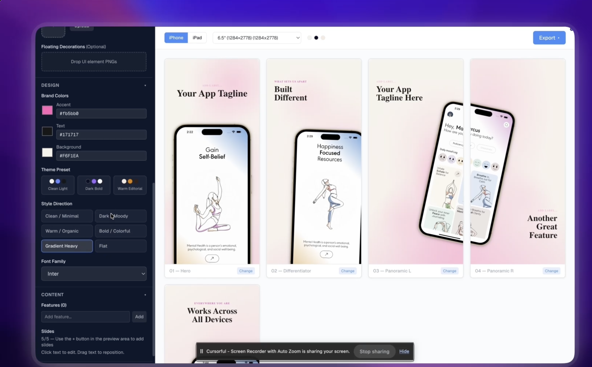

<div align="center">

# 📱 App Store Screenshot Generator

### Free, open-source App Store screenshot maker for iPhone and iPad

Design App Store marketing screenshots in your browser and export them at exact App Store Connect sizes.
**No watermark. No sign-up. No paid tier.**

### 👉 [Open the generator](https://appstore-screenshot-creator.vercel.app)

[](https://nextjs.org/)
[](https://react.dev/)
[](https://www.typescriptlang.org/)
[](https://tailwindcss.com/)
[](LICENSE)

<br />



<br />

[**🚀 Live app**](https://appstore-screenshot-creator.vercel.app) · [**✨ Features**](#-features) · [**📐 Export sizes**](#-supported-export-sizes) · [**💻 Run locally**](#-run-it-locally) · [**🐛 Report a bug**](../../issues)

</div>

---

## 🤔 Why this exists

Good App Store screenshots matter for App Store Optimization (ASO), but making them is slow. Indie developers spend hours in Figma, or pay for subscription tools, and many free tools add watermarks or lock exports behind a paywall.

This is a free alternative that runs entirely in your browser: upload your app screenshots, pick a layout, edit the text, and export PNGs that are ready to upload to App Store Connect.

---

## ✨ Features

### 🎨 Design
- **3 themes:** Clean Light, Dark Bold, and Warm Editorial, plus your own brand colors
- **6 style presets:** Clean / Minimal, Dark / Moody, Warm / Organic, Bold / Colorful, Gradient Heavy, and Flat
- **10 Google Fonts,** including Inter, Poppins, DM Sans, and Space Grotesk
- **Decorative layers:** gradient blobs, glow orbs, device shadows, and your own floating UI elements

### 🧩 7 slide layouts
- **Hero:** app icon, tagline, and phone mockup
- **Differentiator:** what makes your app different
- **Ecosystem:** two-phone layout for multi-device apps
- **Feature Spotlight:** one feature in focus
- **Trust Signal:** a bold, text-only slide
- **More Features:** a grid of feature pills
- **Panoramic Pair:** two slides that connect into one continuous image

### ✏️ Editing
- Click any text on a slide to edit it, and drag it to reposition
- Assign each uploaded screenshot to a specific slide
- See every change in a live preview

### 📤 Export
- Exact App Store Connect sizes for iPhone (5.5" to 6.9") and iPad (10.5" to 13")
- Full-resolution PNGs, one slide at a time or all at once
- Rendered on your device: your screenshots are never uploaded to a server

### 🌍 Languages
- Switch between 14 languages, with right-to-left layouts for Arabic and Hebrew
- Exported files are named by language, so localized sets stay organized

---

## 📐 Supported export sizes

| Device | Size | Resolution |
|--------|------|-----------|
| iPhone 16 Pro Max | 6.9" | 1320 × 2868 |
| iPhone 15 Pro Max | 6.7" | 1290 × 2796 |
| iPhone 15/14 Pro | 6.1" | 1179 × 2556 |
| iPhone (6.5") | 6.5" | 1284 × 2778 |
| iPhone (6.5" alt) | 6.5" | 1242 × 2688 |
| iPhone X/XS | 5.8" | 1125 × 2436 |
| iPhone 8 Plus | 5.5" | 1242 × 2208 |
| iPad Pro M4 | 13" | 2064 × 2752 |
| iPad Pro | 12.9" | 2048 × 2732 |
| iPad Pro | 11" | 1668 × 2388 |
| iPad | 10.5" | 1668 × 2224 |

All sizes match Apple's App Store Connect screenshot requirements.

---

## 🎯 How it works

1. **Upload** your app screenshots and icon
2. **Choose** a theme, style preset, brand colors, and font
3. **Build** a set of up to 5 slides from the 7 layouts
4. **Edit** headlines directly on the slides
5. **Export** PNGs at the exact App Store size you need
6. **Upload** them to App Store Connect

---

## 💻 Run it locally

You only need this to self-host or contribute. To make screenshots, use the [live app](https://appstore-screenshot-creator.vercel.app).

**Prerequisites:** [Node.js](https://nodejs.org/) 18+ and npm, yarn, pnpm, or bun

```bash
git clone https://github.com/mashood100/appstore_screenshot_creator.git
cd appstore_screenshot_creator
npm install
npm run dev
```

Open <http://localhost:3000>. Firebase analytics is optional, and the app works without any configuration.

---

## 🏗️ Project structure

```
app/
├── page.tsx                    # Main dashboard entry
├── layout.tsx                  # Root layout with Geist font
├── globals.css                 # Design tokens + Tailwind
├── lib/
│   ├── firebase.ts             # Firebase config (optional)
│   └── analytics.ts            # Event tracking
└── components/
    ├── context/
    │   └── DashboardContext.tsx # Global state (useReducer)
    ├── canvas/
    │   ├── PreviewGrid.tsx      # Slide grid + add button
    │   ├── ScreenshotPreview.tsx # Individual slide card
    │   ├── OffscreenRenderer.tsx # Hidden render target for export
    │   ├── ScreenshotAssigner.tsx
    │   └── SlideDesignPicker.tsx # Slide type selector modal
    ├── slides/
    │   ├── HeroSlide.tsx
    │   ├── DifferentiatorSlide.tsx
    │   ├── EcosystemSlide.tsx
    │   ├── CoreFeatureSlide.tsx
    │   ├── TrustSignalSlide.tsx
    │   ├── MoreFeaturesSlide.tsx
    │   ├── PanoramicSlide.tsx
    │   ├── DraggableCaption.tsx
    │   └── SlideWrapper.tsx
    ├── sidebar/
    │   ├── Sidebar.tsx          # Collapsible config panel
    │   ├── ScreenshotUploader.tsx
    │   ├── IconUploader.tsx
    │   ├── UIElementUploader.tsx
    │   ├── ColorPicker.tsx
    │   ├── ThemeSelector.tsx
    │   ├── StyleSelector.tsx
    │   ├── FontSelector.tsx
    │   ├── FeatureListEditor.tsx
    │   ├── LocaleManager.tsx
    │   └── SlideCountSelector.tsx
    ├── toolbar/
    │   └── Toolbar.tsx          # Device + size + export controls
    ├── mockups/
    │   ├── Phone.tsx            # iPhone frame component
    │   └── IPad.tsx             # iPad frame component
    ├── decorative/
    │   ├── GradientBlob.tsx     # Background decoration
    │   └── GlowOrb.tsx         # Accent glow effect
    ├── typography/
    │   └── Caption.tsx          # Slide text renderer
    ├── export/
    │   └── useExport.ts         # PNG export via html-to-image
    ├── constants.ts             # Themes, sizes, configs
    └── types.ts                 # TypeScript interfaces
```

---

## 🛠️ Tech stack

| Technology | Purpose |
|-----------|---------|
| **Next.js 16** | App framework with App Router |
| **React 19** | UI rendering |
| **TypeScript** | Type safety |
| **Tailwind CSS 4** | Utility-first styling |
| **html-to-image** | Client-side PNG export |
| **Firebase** | Analytics (optional) |
| **Geist Font** | Default typography |

---

## ❓ FAQ

**Is it really free?**
Yes. It's MIT licensed, with no watermark, no account, and no paid tier.

**Are my screenshots uploaded anywhere?**
No. Images stay in your browser, and the PNG export happens on your device. The live site uses basic analytics to count exports, which never include your images or text.

**Which stores and devices are supported?**
iPhone and iPad screenshots for the Apple App Store. Google Play and Mac App Store screenshots aren't supported yet.

**Can I use it for commercial apps?**
Yes. The MIT license allows personal and commercial use.

---

## 🤝 Contributing

Contributions are welcome.

1. **Fork** the project
2. **Create** a feature branch (`git checkout -b feature/amazing-feature`)
3. **Commit** your changes (`git commit -m 'Add amazing feature'`)
4. **Push** the branch (`git push origin feature/amazing-feature`)
5. **Open** a pull request

### Ideas for contributions

- [ ] Google Play screenshot sizes
- [ ] Mac App Store screenshot support
- [ ] More theme presets (neon, pastel, monochrome)
- [ ] More slide layouts (testimonial, pricing, comparison)
- [ ] Reorder slides with drag and drop
- [ ] Gradient background editor

---

## ⭐ Support

If this tool saved you time or money:

- ⭐ **Star this repo** so other developers can find it
- 🐛 **Report bugs** to help make it better
- 📢 **Share it** with other indie developers
- 🛠️ **Contribute** a feature from the list above

---

## 📜 License

Distributed under the **MIT License**. See [`LICENSE`](LICENSE) for details.

Use it freely in personal and commercial projects. Attribution isn't required, but it's appreciated.

---

## 🙏 Acknowledgments

- [Next.js](https://nextjs.org/): the React framework
- [html-to-image](https://github.com/bubkoo/html-to-image): client-side image generation
- [Geist Font](https://vercel.com/font): typography by Vercel
- [Google Fonts](https://fonts.google.com/): fonts for every style
- Apple's [App Store Connect](https://developer.apple.com/app-store-connect/): screenshot size reference

---

<div align="center">

**Built for indie developers everywhere.**

If a paid tool can do it, an open-source one should too.

</div>
